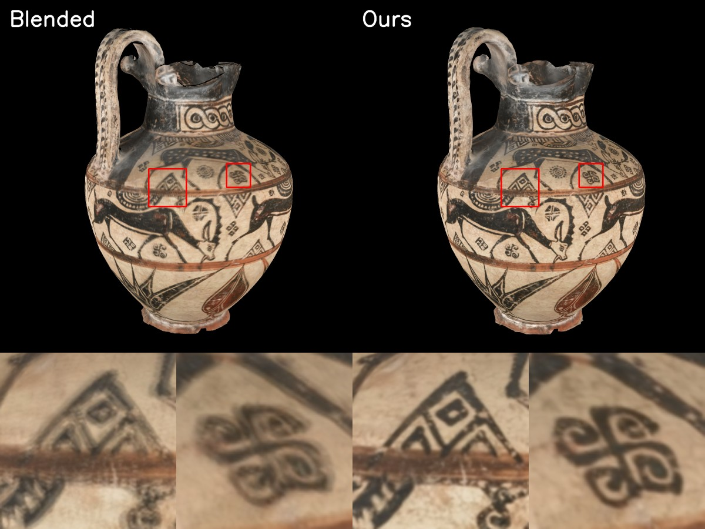

# Texture Consolidation

[](https://hliuw.github.io/texture-consolidation/) [](https://arxiv.org/abs/2610.36098)

Code for the paper [**Texture Consolidation of Generated Multi-View Renderings**](https://arxiv.org/abs/2610.36098).

- **Input:** a texture-atlased triangle mesh, and a few renderings or photographs of it with known cameras.
- **Output:** a single seamless texture image for the mesh.

The code has three steps:

| Step | Program | What it does |
|---|---|---|
| 1 | `BackProjection` | Projects each image onto the mesh, giving a texture and a confidence image per view. |
| 2 | `TextureFlow` | Registers the per-view textures to each other with optical flow on the surface. |
| 3 | `TextureDomainStitching` | Fuses the registered textures into one texture by gradient-domain stitching. |

`TextureDomainStitching` is built from [TextureSignalProcessing](https://github.com/mkazhdan/TextureSignalProcessing).

## Building

Clone with the submodules ([Misha](https://github.com/mkazhdan/Misha), [PhongRodriguesVF](https://github.com/mkazhdan/PhongRodriguesVF), [TextureSignalProcessing](https://github.com/mkazhdan/TextureSignalProcessing)):

```bash
git clone --recursive https://github.com/hliuw/TextureConsolidation.git
cd TextureConsolidation
```

The code needs a C++20 compiler, CMake, OpenMP, and the libpng, libjpeg and zlib libraries.

### Linux

Tested on Ubuntu 24.04 with gcc 13.3 and CMake 3.28.

```bash
sudo apt install cmake libpng-dev libjpeg-dev zlib1g-dev
cmake -S . -B build -DCMAKE_BUILD_TYPE=Release
cmake --build build -j
```

The programs are in `build/`.

### Windows

We recommend Visual Studio with [vcpkg](https://github.com/microsoft/vcpkg). Tested with Visual Studio 2026 (MSVC 19.51), CMake 4.2, and vcpkg (libpng 1.6.58, libjpeg-turbo 3.1.4, zlib 1.3.2).

```bash
cmake -S . -B build -DCMAKE_TOOLCHAIN_FILE=<vcpkg>/scripts/buildsystems/vcpkg.cmake
cmake --build build --config Release
```

Replace `<vcpkg>` with the folder where vcpkg is installed. vcpkg should then install libpng, libjpeg and zlib automatically when CMake configures (see `vcpkg.json`). The programs are in `build/Release/`.

If you prefer not to use vcpkg, you can install libpng, libjpeg and zlib yourself and tell CMake where they are, e.g. with `-DCMAKE_PREFIX_PATH=<folder containing the libraries>`. CMake finds them with its standard `find_package` modules.

## Input format

A dataset is a folder with three parts:

- **Mesh:** a texture-atlased triangle mesh, as a binary PLY with `vertex_indices` and a per-face `texcoord` list (6 values per triangle).
- **Cameras:** `cameras.json` in this format:
  ```json
  { "frames": [ { "w": 1002, "h": 1336, "fx": 4488.7, "fy": 4488.7, "cx": 501.0, "cy": 668.0,
                  "w2c": [ [...], [...], [...], [0, 0, 0, 1] ], "file_path": "images/0.png" }, ... ] }
  ```
  `w2c` is the 4×4 world-to-camera matrix, and `fx, fy, cx, cy` are the pinhole intrinsics in pixels.
- **Images:** one rendering or photograph per camera, at the `file_path` given in `cameras.json` (relative to the folder of `cameras.json`). For example, the vase used in the [example run](#example-run) has 9 photographs:

  

Views are numbered `0 .. N-1` in the order of `cameras.json`. Files belonging to view `i` are named with a `%d` pattern, e.g. `backprojected/%d.png` means `backprojected/0.png`, `backprojected/1.png`, ...

**Using your own data:** 
- Cameras follow the OpenCV convention.
- The parameters of `TextureFlow` depend on the scale of the mesh.
- `TextureDomainStitching` requires a connected mesh with a clean texture atlas. Otherwise it may crash with errors (for example, "Bad components"). If this happens, fixing the mesh or regenerating the atlas usually helps.

## Example run

This example uses 9 photographs of a vase, with its mesh and cameras. Download and unpack the data:

```bash
curl -L -o vase.zip https://github.com/hliuw/TextureConsolidation/releases/download/example-data/vase.zip
unzip vase.zip
```

Then run the three steps (on Windows, use `build/Release/` instead of `build/`):

```bash
build/BackProjection --mesh vase/mesh.ply --cameras vase/cameras.json --res 2048 2048 --outTextures vase/backprojected/%d.png --outConfidences vase/backprojected/%d.confidence.png
build/TextureFlow --mesh vase/mesh.ply --inTextures vase/backprojected/%d.png --inConfidences vase/backprojected/%d.confidence.png --outTextures vase/registered/%d.png --outConfidences vase/registered/%d.confidence.png
build/TextureDomainStitching --in vase/mesh.ply vase/registered/%d.png --mask vase/registered/%d.confidence.png --multi --wType 1 --erode 1 --erodeEps 0.1 --out vase/texture.png
```

The final texture image is stored in `vase/texture.png`. `vase/mesh.ply` refers to this texture, so you can view the textured vase in a third-party mesh viewer such as [MeshLab](https://www.meshlab.net/).

Below we show the blended back-projected photographs, and our result after registration and stitching. Note that the ghosting is resolved by registration. You can also compare them in an interactive 3D viewer on our [project page](https://hliuw.github.io/texture-consolidation/#real-photographs).



## Programs

### BackProjection

| Option | Default | Description |
|---|---|---|
| `--mesh` | | input mesh |
| `--cameras` | | input `cameras.json` |
| `--images` | folder of `cameras.json` | folder the image paths are relative to |
| `--outTextures`, `--outConfidences` | | output patterns, e.g. `backprojected/%d.png` |
| `--res` | `1024 1024` | texture resolution |
| `--depthRadius` | `20` | falloff of the confidence near depth discontinuities, in pixels ($r_{dc}$) |
| `--cutoff` | `0.05` | confidences below this are set to zero |

### TextureFlow

| Option | Default | Description |
|---|---|---|
| `--mesh` | | input mesh |
| `--inTextures`, `--inConfidences` | | input patterns (the output of `BackProjection`) |
| `--outTextures`, `--outConfidences` | | output patterns for the registered textures |
| `--levels` | `6` | number of hierarchy levels ($L$) |
| `--sDiffusion` | `3e-4` | smoothing of the source and target ($\beta_{blur}$) |
| `--sWeight` | `0.5` | smoothness of the flow ($\beta_{reg}$) |
| `--factor` | `0.5` | scaling of $\beta_{blur}$ and $\beta_{reg}$ per level |
| `--normalization` | `1e-3` | extent of the color normalization ($\epsilon_n$) |
| `--sub` | `1` | number of times the mesh is subdivided 1-to-4 before computing the flows |
| `--erode`, `--erodeEps` | `1`, `0.2` | confidence erosion used when computing the flows (see [Confidence erosion](#confidence-erosion)) |
| `--minStep` | `1e-2` | minimum advection step size |
| `--anchorWeight` | `1` | weight of the term anchoring the textures to the unregistered blend. Higher values keep the textures closer to their original locations, possibly at the cost of weaker registration; `0` disables anchoring |
| `--anchorDecay` | `0.7` | per-level multiplier of the anchor weight, from coarse to fine levels. Lower values weaken the anchoring at the finer levels, where high-frequency details are registered |

### TextureDomainStitching

See the [TextureSignalProcessing documentation](https://github.com/mkazhdan/TextureSignalProcessing) for all options. For this pipeline, use:

| Option | Description |
|---|---|
| `--in <mesh> <texture pattern>` and `--mask <confidence pattern>` | the registered textures and confidences |
| `--multi` | **required**: stitch multiple textures |
| `--wType 1` | **required**: weight both the value and the gradient terms by confidence |
| `--erode 1 --erodeEps 0.1` | confidence erosion (see [Confidence erosion](#confidence-erosion)) |
| `--gWeight` | gradient fitting weight ($\alpha_{gf}$), default `0.01` |
| `--out` | output texture |

### Confidence erosion

`--erode <radius> --erodeEps <threshold>` zeroes confidences at or below the threshold, and those closer than `radius` texels to them. With `--erode 1`, only the threshold applies. In `TextureFlow`, erosion affects only the flow computation, not the output confidences.

## Acknowledgements

The vase model and photographs used in the [example run](#example-run) are courtesy of Paolo Cignoni and Marco Callieri, [Visual Computing Laboratory, ISTI-CNR](https://vcg.isti.cnr.it/). We thank them for sharing this data and their code with us.

## Citation

If you find our work useful, please consider citing:

```bibtex
@misc{liu2026texture,
  title         = {Texture Consolidation of Generated Multi-View Renderings},
  author        = {Liu, Hongyi and Wang, Yifan and Kim, Vladimir G. and Kazhdan, Misha},
  year          = {2026},
  eprint        = {2610.36098},
  archivePrefix = {arXiv},
  primaryClass  = {cs.GR},
  url           = {https://arxiv.org/abs/2610.36098}
}
```
